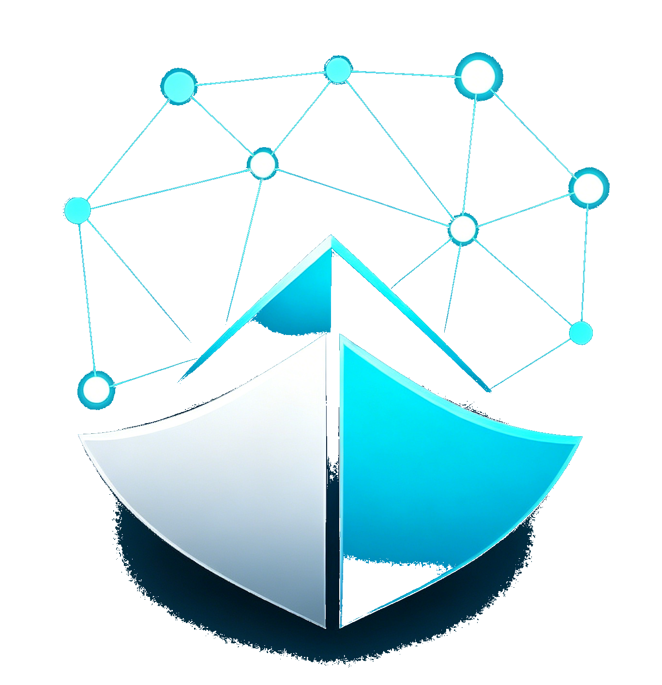

<div align="center">
  

  <h1>ClueArk</h1>

  <p>
    <a href="./README_ZH.md">简体中文</a> |
    <a href="./README.md">English</a>
  </p>

  <p>
    <strong>An AI-powered intelligence aggregation platform for individuals and teams.</strong>
  </p>

  <p>
    ClueArk organizes information around <strong>topic monitoring</strong>: you describe a monitor in one sentence; the backend uses an LLM to expand the brief and bind sources, then embeddings power a semantic timeline and scheduled briefs. Underneath, it ingests public sources such as RSS, web crawling, and hot-topic APIs, with optional LLM enrichment, embedding-based matching, and clustering of similar stories so users can surface actionable signals in noisy streams. The project is a lightweight, self-hostable information workspace suited to industry research, technology trend tracking, public-event observation, and personal knowledge intake.
  </p>
</div>

Repository: [https://github.com/lqomg/ClueArk](https://github.com/lqomg/ClueArk)

Demo: [https://clueark.com](https://clueark.com)

> Built with React + TypeScript + NestJS + MongoDB + Docker, ClueArk is a full-stack reference with a frontend-oriented perspective, and can serve as a practical starting point for frontend developers learning full-stack delivery.


## Features

- **Unified source model**: Official built-in entries and user-created sources share the same types and fingerprinting strategy for easier extension and operations.
- **AI-assisted topic monitors**: Create a monitor from a short intent sentence; the system expands the brief, extracts keywords and entities, and recommends bound sources from the enabled pool. You can adjust bound sources and the cosine threshold (`minCosine`) in settings. The timeline and sidebar metrics rely on embeddings; briefs are generated asynchronously by a backend scheduler (see **Topic monitoring** below).
- **Multiple ingestion paths**: One pool supports **RSS/Atom**, **Web (optional list-page crawling)**, and **JSON hot-topic APIs (configurable field mapping)**—pick what fits instead of a single crawl mode.
- **Standalone web crawler service**: For sites without a stable feed, list pages are parsed with **CSS selectors** (NestJS + Cheerio) and reported to the main app with a **contract-aligned** payload; the crawler does not depend on an LLM. See [`crawler/README.md`](crawler/README.md).
- **Optional intelligence**: Wire in DeepSeek, item enrichment, embeddings, clustering, and related features via environment variables (root `.env.example` and `backend/.env.example`). **Creating a monitor** requires embeddings to be enabled, and feed items need compatible semantic vectors for the timeline to populate.
- **Docker Compose single-node stack**: MongoDB, **Redis**, **Qdrant**, backend API, **BullMQ Worker**, user web app, **standalone admin console**, and crawler are built and started together by default for quick deployment.
- **Monitor-first read model**: List views and intelligence metrics are served from materialized `monitor_snapshots`; vectors live only in Qdrant; new items flow through the queue: embed → match → in-app notification.

Personal intelligence collection: subscribe to topics on the shared pool, read a semantically filtered timeline, and review generated briefs with less manual searching.

## Roadmap

> `[x]` shipped · `[ ]` planned · `[~]` partial

### Shipped

- [x] **AI topic monitors**: One-sentence intent → LLM brief, source planning, and binding
- [x] **Multiple public source types**: RSS/Atom, web list crawler (Cheerio + CSS selectors), JSON hot-topic API (`hot_api`)
- [x] **Built-in source catalog**: 50+ Chinese/English RSS and web examples (`data/built-in-catalog.json`)
- [x] **Semantic matching & clustering**: Embeddings + Qdrant; incremental similar-article clustering
- [x] **LLM item enrichment**: Async summaries and recommendation copy (does not block match notifications)
- [x] **Match notifications (in-app)**: In-app alerts with dedupe and cooldown
- [x] **Intelligence briefs**: Async rolling-window reports (default: last 7 days)
- [x] **Monitor snapshot read model**: Fast list/overview reads (`monitor_snapshots`)
- [x] **User timezone**: IANA timezone in profile; lists and trends bucketed by user calendar
- [x] **Product i18n**: Multi-language support in user frontend, admin console, and backend error/notification messages (zh-CN, en, ja, ko)
- [x] **Standalone admin console**: Users, monitors, sources, and job audit (separate from user app)
- [x] **Docker Compose one-click deploy**: MongoDB, Redis, Qdrant, API, Worker, frontends, and crawler in one stack
- [x] **Email OTP auth**: Registration, login, and password reset (verification code logged when SMTP is not configured, for local development)
- [x] **Async job pipeline**: BullMQ (ingest → embed → match → notify / enrich)

### Planned

- [～] **Native social platform integrations**
  - [～] **X (Twitter)**: Timelines, keyword search, or list-page ingestion
  - [ ] More: Zhihu, Toutiao, Xiaohongshu, etc. (phased rollout)
- [ ] **More built-in platform sources**: Hot API templates and preset configs
- [ ] **Calendar-based brief windows**: Daily/weekly/monthly briefs (`calendar_range`)
- [ ] **Real-time notifications**: SSE / WebSocket instead of polling unread counts
- [ ] **Mobile native app (iOS / Android)**: Current version is web-only; no mobile client, system-level push, or app update checking

Discuss priorities or pick up tasks via [Issues](https://github.com/lqomg/ClueArk/issues). See [AGENTS.md](AGENTS.md) for architecture conventions.

## Topic monitoring (how it works)

- **Create**: You enter a short monitoring intent. The backend calls an LLM for title, long-form description, keywords, and entities, then picks bound sources. The description vector is stored in **Qdrant** (MongoDB only holds metadata). After creation, the first snapshot is computed asynchronously (`snapshotStatus: computing` → `ready`).
- **Semantic timeline**: Items are retrieved via Qdrant search + `minCosine` filtering; the HTTP read path never does full cosine computation. Only sources **bound to at least one monitor** enter the embed/enrichment pipeline after ingestion.
- **Intelligence cards and trends**: `GET /monitors` list includes lightweight metrics (prefers `monitor_snapshots`); intelligence details use `GET /monitors/:id/intelligence`.
- **Intelligence briefs**: Generated asynchronously via the `brief` queue; evidence comes from Qdrant search; results are written to MongoDB. Configured via `MONITOR_BRIEF_*` variables.
- **Notifications**: When an item matches a monitor, a record is written to `notifications`; view at `/app/notifications`.

## Source types

| Type | Description | Typical use |
|------|-------------|-------------|
| **RSS / Atom** | Incremental fetch from standard feed URLs | News sites, blogs, and other sources that publish feeds |
| **Web** | Site URL; optional `crawlListUrl` + `crawlSelectors` for the crawler to parse list pages | Pages with HTML lists only, where rule-based extraction is enough |
| **Hot API (`hot_api`)** | JSON over HTTP + configurable mapper (e.g. array path and field mapping) | Structured hot lists and leaderboard-style APIs |

Built-in seeds live in **`data/built-in-catalog.json`** (includes RSS examples). Set **`BUILTIN_CATALOG_PATH`** to point at a custom catalog at deploy time.

## Demo

- **User app:** [https://clueark.com](https://clueark.com) — anyone can register as a normal user.
- **Admin console (self-hosted):** `http://<host>:8081` by default (`ADMIN_WEB_PORT`); sign in with the seeded admin (`ADMIN_EMAIL` / `ADMIN_PASSWORD`) via `POST /api/admin/auth/login`.

## Tech stack

| Area | Stack |
|------|-------|
| User app | React 18, TypeScript, Vite, Tailwind CSS, Zustand, React Router |
| Admin console | React 18, TypeScript, Vite, Ant Design, ProComponents |
| Backend | NestJS, MongoDB (Mongoose), Redis/BullMQ, Qdrant, JWT, scheduled tasks |
| Crawler | NestJS, Cheerio, configurable selectors (contract-aligned with the main app) |

`frontend/` (user app), `admin-web/` (admin console), `backend/`, and `crawler/` are independent subprojects. There is no unified root `package.json`.

## Repository layout (excerpt)

```
├── backend/           # Main API (NestJS)
├── crawler/           # Web list crawler (NestJS); see crawler/README.md
├── frontend/          # User web app (Vite + React)
├── admin-web/         # Standalone admin console (Vite + React + Ant Design)
├── data/              # Built-in source seeds (e.g. built-in-catalog.json)
├── docker-compose.yml # Recommended deploy entry
├── .env.example       # Env template (copy to .env)
└── LICENSE            # MIT
```

## Sources and built-in catalog

All sources share one pool (MongoDB `sources` collection): official-style rows have empty `createdBy`; user-created rows record the creator.

The repo's **`data/built-in-catalog.json`** (`sources` array) is only a **bootstrap seed** for writing official-site-style sources. Override the path with **`BUILTIN_CATALOG_PATH`** (in Docker, this is typically a path mounted into the container).

## Requirements

- **Recommended:** Docker, Docker Compose (v2)
- **Local development:** Node.js 20+ (aligned with subprojects), MongoDB

## Deployment (Docker Compose, recommended)

Root `docker-compose.yml` is the **recommended single-machine entry**: MongoDB + backend + web (user app) + admin-web (admin console) + crawler.

### First start

```bash
git clone <repository-url>
cd <cloned-directory>

cp .env.example .env
# Edit .env: use strong passwords/secrets in production, including at least:
#   MONGO_INITDB_ROOT_PASSWORD, JWT_SECRET, ADMIN_PASSWORD
#   CRAWLER_INGEST_SECRET, CRAWLER_SECRET (crawler ↔ backend; see .env.example)

docker compose up -d --build
```

### Access

- **User web:** `http://<server-ip-or-domain>:<port>`
  - If you copied `.env.example` and keep `WEB_PORT=8080`, this is usually **`http://<host>:8080`**.
  - If there is no `.env` or `WEB_PORT`, Compose maps container port 80 to host **`80`** by default (`http://<host>/`).
- **Admin console:** default **`http://<host>:8081`** (`ADMIN_WEB_PORT`); admin accounts only.
- **HTTP API:** Proxied through **`/api`** via Nginx on the frontend and admin containers; the backend port is **not** exposed separately.

### Network and security

- Under default Compose, **`backend`** and **`crawler`** do **not** publish host ports; they talk on the internal network.
- MongoDB is published on **`MONGO_BIND_PORT`** (default **27017**). If the host is on the public internet, restrict source IPs in firewall/security groups; **avoid exposing the database port without protection**.

### Crawler service

It is **built and started by default** with `docker compose up`, fetching configured web sources and reporting to the main app. For manual runs, APIs, and schedules, see **[crawler/README.md](crawler/README.md)**.

If you only need the main app and database for now, adjust Compose (e.g. remove or disable the `crawler` service) according to your ops policy.

## Environment variables (summary)

Full keys and comments are in **`/.env.example`**; **`backend/.env.example`** and **`crawler/.env.example`** support local development.

| Category | Description |
|----------|-------------|
| Must change (production) | Mongo root password, `JWT_SECRET`, `ADMIN_PASSWORD`, crawler secrets such as `CRAWLER_INGEST_SECRET` / `CRAWLER_SECRET` |
| Optional | DeepSeek, embedding, RSS/hot API toggles and keys (see each `.env.example`) |
| Monitors and briefs | `MONITOR_*`, `MONITOR_BRIEF_*` (documented in `backend/.env.example`) |

## Local development

Each subproject installs and runs on its own. Provide MongoDB and connection settings.

```bash
# Backend (example)
cd backend
cp .env.example .env   # adjust for your machine
npm install
npm run start:dev

# Frontend (example)
cd frontend
npm install
npm run dev

# Crawler (example)
cd crawler
cp .env.example .env
npm install
npm run start:dev
```

For local integration, keep API URLs, proxies, and env vars consistent with Vite / Nest configs.

## Compliance and security

When using this software to crawl or access third-party sites, comply with applicable laws, each site's terms, `robots.txt`, and reasonable use. Do not use it for unauthorized bulk crawling or rights violations; **you are responsible for compliance**.

If you find security issues in deployment (default secrets, exposure, etc.), contact maintainers privately when appropriate; fixes and documentation/PRs are welcome.

## License

This project is open source under the **[MIT License](LICENSE)**.

## Contributing

Issues and pull requests are welcome. Keep commit messages concise; internal workflows may use types such as `fix` and `feature`.
