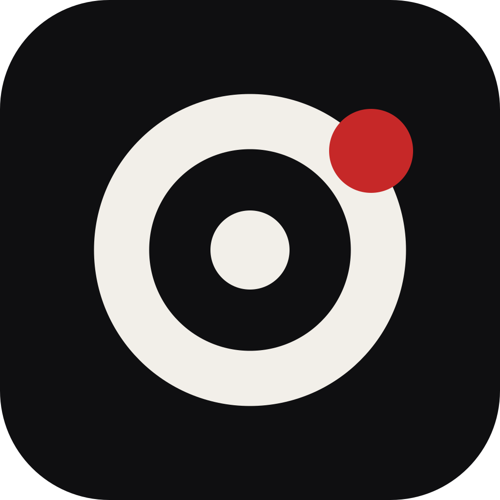

<div align="center">
  

  <h1>ClueArk</h1>

  <p>
    <a href="./README_ZH.md">简体中文</a> |
    <a href="./README.md">English</a>
  </p>

  <p>
    <strong>An AI-powered intelligence workspace for individuals and teams.</strong>
  </p>

  <p>
    ClueArk organizes information around <strong>topic monitors</strong>: describe an intent in one sentence; the backend uses an LLM to expand the brief and bind public sources; embeddings power a semantic timeline, match notifications, and scheduled intelligence briefs. Ingest RSS/Atom, web list pages, and JSON hot-topic APIs into one source pool. Self-hostable with Docker Compose.
  </p>
</div>

Repository: [https://github.com/lqomg/ClueArk](https://github.com/lqomg/ClueArk)

Demo: [https://clueark.com](https://clueark.com)

> Stack: React + TypeScript + NestJS + MongoDB + Redis + Qdrant + Docker. A practical full-stack reference with a frontend-oriented perspective.

<p align="center">
  
</p>

<p align="center">
  
</p>

## Features

- **Unified source model**: Built-in and user-created sources share types and fingerprinting.
- **AI-assisted topic monitors**: One-sentence intent → LLM brief, keywords/entities, recommended bindings; tune sources and `minCosine` in settings.
- **Multiple ingestion paths**: **RSS/Atom**, **Web** (Cheerio list crawler), **JSON hot APIs** (`hot_api`).
- **Standalone crawler**: Contract-aligned list-page ingestion; no LLM in the crawler. See [`crawler/README.md`](crawler/README.md).
- **Embeddings + Qdrant**: Semantic timeline and clustering; vectors stay out of MongoDB.
- **Async pipeline**: BullMQ worker — ingest → embed → match → in-app notify / enrich / snapshot / brief.
- **Monitor snapshots**: Fast list/overview reads from `monitor_snapshots`.
- **Docker Compose stack**: MongoDB, Redis, Qdrant, API, Worker, user web, admin web, crawler.

## Roadmap

> `[x]` shipped · `[ ]` planned · `[~]` partial

### Shipped

- [x] AI topic monitors (create, bind sources, semantic timeline)
- [x] RSS / Web crawler / `hot_api` sources + built-in catalog
- [x] Embeddings + Qdrant match & clustering
- [x] LLM enrichment, in-app match notifications, rolling briefs
- [x] `monitor_snapshots` read model, user timezone, i18n (zh-CN / en / ja / ko)
- [x] Standalone admin console + Compose one-click deploy + email OTP auth

### Planned

- [ ] Topic developments timeline (gated, verifiable updates—not only raw matched items)
- [ ] Chat-assisted topic create / tune
- [ ] Cross-topic home feed (today / following / picks)
- [ ] Official topic catalog and subscribe
- [ ] Richer multi-locale development localization
- [~] Native social ingestion (e.g. X) and more built-in hot sources
- [ ] Real-time notifications (SSE / WebSocket)

Discuss priorities via [Issues](https://github.com/lqomg/ClueArk/issues).

## How topic monitoring works

- **Create**: Short intent → LLM title/description/keywords/entities + bound sources; description vector in **Qdrant**.
- **Timeline**: Qdrant search + `minCosine`; HTTP read path does not run full-library cosine.
- **Briefs**: Async `run_brief` jobs; evidence from Qdrant; see `MONITOR_BRIEF_*`.
- **Notifications**: Matches write `notifications` (in-app).

## Source types

| Type | Description |
|------|-------------|
| **RSS / Atom** | Standard feeds |
| **Web** | Optional `crawlListUrl` + CSS selectors via crawler |
| **Hot API** | JSON HTTP + field mapper |

Seeds: **`data/built-in-catalog.json`** (`BUILTIN_CATALOG_PATH`).

## Demo

- **User app:** [https://clueark.com](https://clueark.com)
- **Admin (self-host):** `http://<host>:8081` (`ADMIN_WEB_PORT`); `ADMIN_EMAIL` / `ADMIN_PASSWORD`

## Tech stack

| Area | Stack |
|------|-------|
| User app | React 18, TypeScript, Vite, Tailwind, Zustand |
| Admin | React 18, Vite, Ant Design |
| Backend | NestJS, MongoDB, Redis/BullMQ, Qdrant |
| Crawler | NestJS, Cheerio |

## Layout

```
├── backend/           # API + worker
├── crawler/           # Web list crawler
├── frontend/          # User web
├── admin-web/         # Admin console
├── data/              # Built-in source seeds
├── docs/              # Extra docs (when present)
├── assets/            # README images & brand mark
├── docker-compose.yml
├── .env.example
└── LICENSE            # MIT
```

## Requirements

- **Deploy:** Docker Compose v2
- **Local dev:** Node 20+, MongoDB, Redis, Qdrant

### Required runtime env (process exits if missing)

| Key | Purpose |
|-----|---------|
| `REDIS_URL` | BullMQ + worker heartbeat |
| `QDRANT_URL` | Vector store |
| `FEED_EMBEDDING_API_KEY` | Embeddings for monitors/timeline |
| `DEEPSEEK_API_KEY` | LLM (monitor create, enrich, briefs) |

Also set strong `JWT_SECRET`, `MONGO_INITDB_ROOT_PASSWORD`, `ADMIN_PASSWORD`, `CRAWLER_INGEST_SECRET` / `CRAWLER_SECRET` in production.

## Deploy (Compose)

```bash
git clone https://github.com/lqomg/ClueArk.git
cd ClueArk
cp .env.example .env
# fill required keys above
docker compose up -d --build
```

- **User web:** `WEB_PORT` (example `8080`) or host `80` if unset
- **Admin:** `ADMIN_WEB_PORT` (default `8081`)
- **API:** via `/api` on the gateway / frontend proxy

Do **not** run `docker compose down -v` on a live volume unless you intend to wipe data.

## Local development

```bash
cd backend && cp .env.example .env   # set REDIS/QDRANT/embedding/DeepSeek
npm install && npm run dev          # API + worker

cd frontend && npm install && npm run dev
cd admin-web && npm install && npm run dev
cd crawler && cp .env.example .env && npm install && npm run start:dev
```

## Compliance

Respect laws, site terms, and `robots.txt`. You are responsible for how you crawl.

## License

**[MIT License](LICENSE)**

## Contributing

Issues and PRs welcome. Prefer concise commits (`fix` / `feature`). Architecture notes: [AGENTS.md](AGENTS.md).
